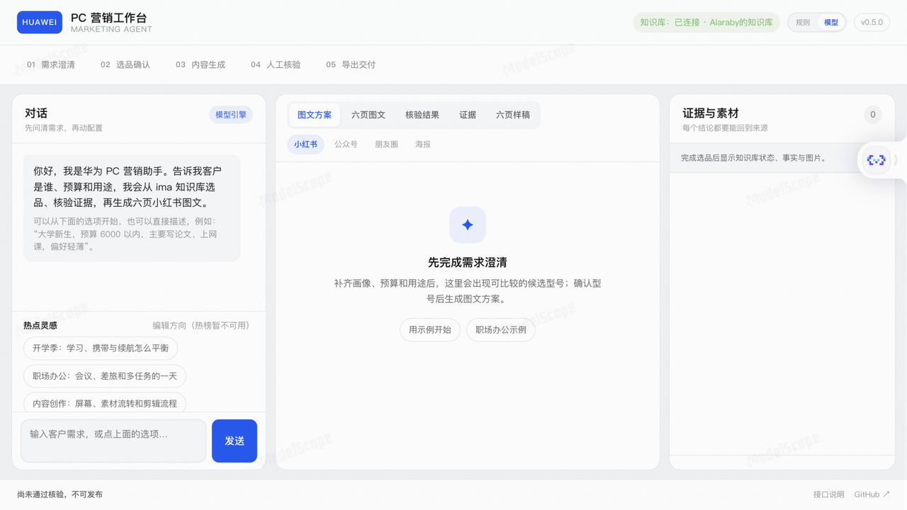
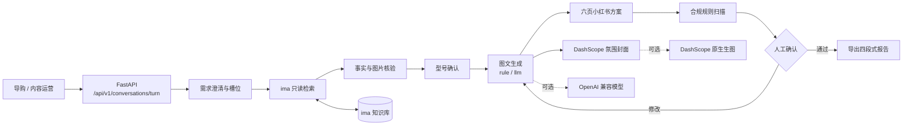
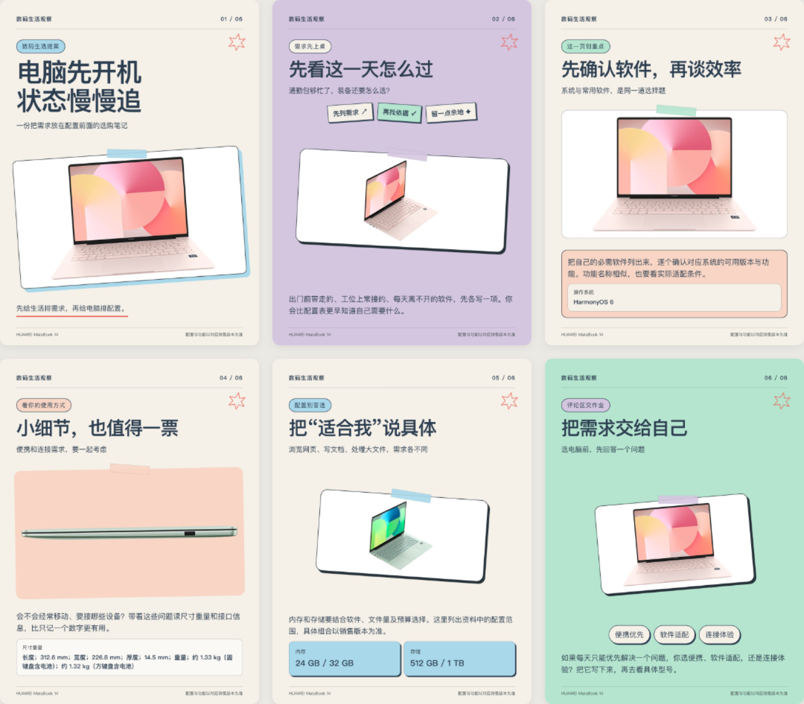
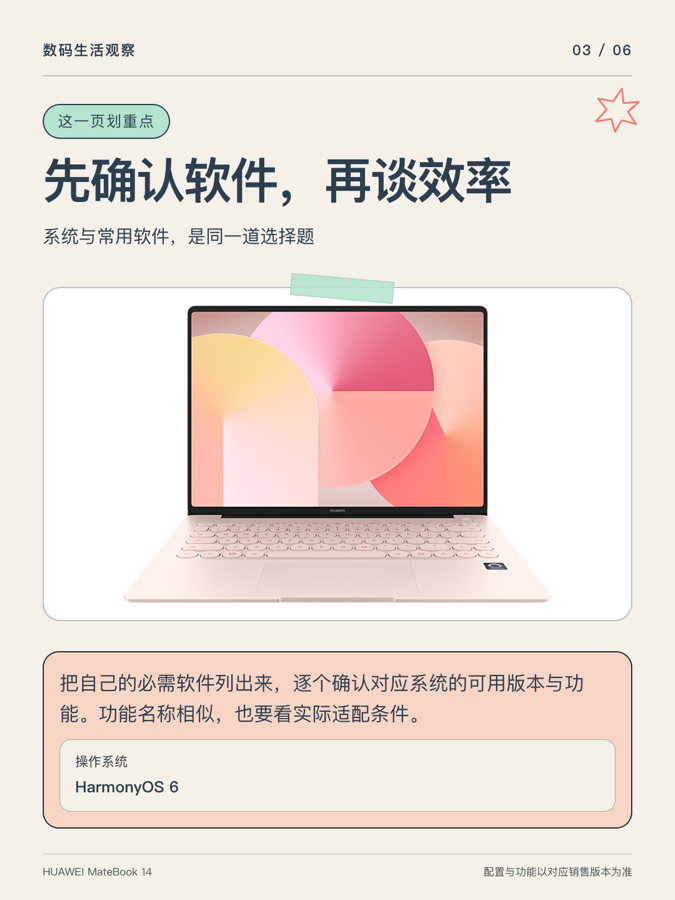
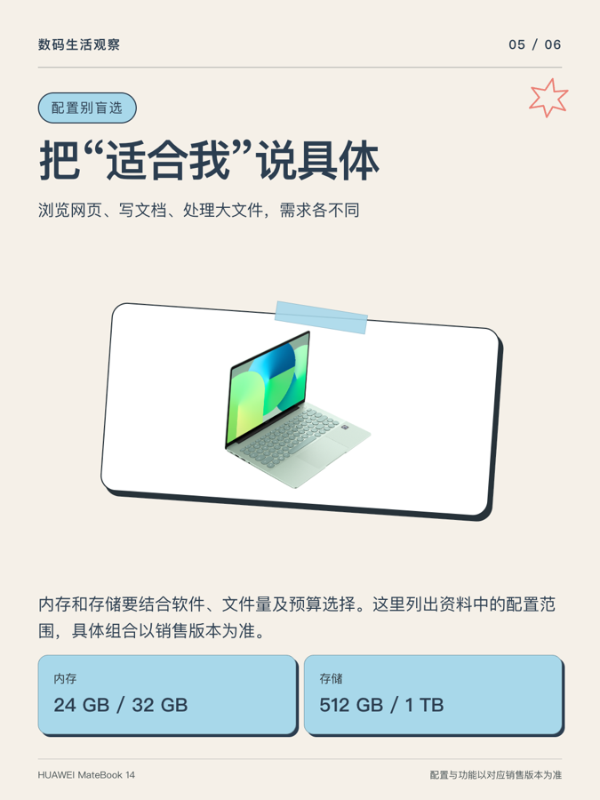
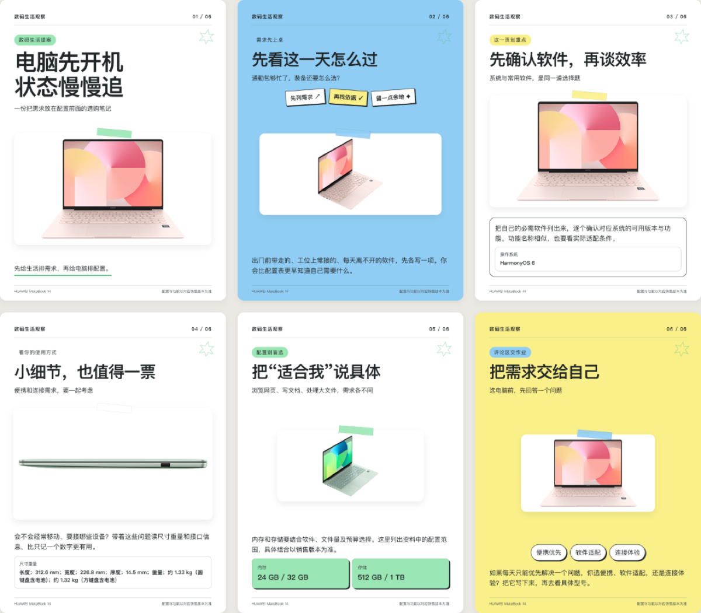

# 华为 PC 营销图文工作台

[](https://github.com/cangyuyi/huawei-pc-marketing-agent/actions/workflows/ci.yml)
[](https://github.com/cangyuyi/huawei-pc-marketing-agent/actions/workflows/container.yml)

面向华为 PC 门店导购与内容运营的营销 Agent：**澄清客户需求 → 在 ima 知识库核验产品事实与图片 → 确认型号 → 生成平台图文 → 合规规则扫描 → 人工确认后导出**。

> **当前版本：v0.7.0（已在魔搭公开部署，个人库联调）**
>
> 已实现：自由输入优先（先理解需求，缺什么问什么）、WorkBuddy 式逐题选项卡片、工具/技能调用轨迹、多轮需求澄清、中文槽位提取、选品与硬约束核验、ima 只读检索与目录回退、规格章节与脚注提取、同型号图片核验、规则/LLM 双引擎、输入区内模型选择与服务端白名单、**六页小红书图文方案**、**六页 1080×1440 PNG 导出**、合规规则扫描、两道人工确认、四段式报告导出、**DashScope 原生异步生图**、热点灵感与内容目标步骤可选热点、HarmonyOS 风格 PC 工作台。
>
> 未完成：赛事指定共享知识库接入、逐条语义核验、多 worker 会话存储、公网鉴权与限流。个人库联调始终标记 `competition_ready=false`。

## 线上实例

- 魔搭创空间（Public / Running）：https://www.modelscope.cn/studios/cangyuyi/huawei-pc-marketing-agent
- 直接应用：https://cangyuyi-huawei-pc-marketing-agent.ms.show/
- API 专用地址（脚本调用需 ModelScope token）：https://studio-cangyuyi-huawei-pc-marketing-agent.api-inference.modelscope.net
- 当前知识库：`华为PC全板块深度知识库_v7（本地官方导出）`，10 个重点型号、68 张索引图片；`KB_SOURCE=local` 直接读取官方 ZIP。它不是实时 ima 调用，`competition_ready=false`；ZIP 不提交 GitHub，部署时放入 `data/official-kb-v7.zip`。



> 截图来自 Public / Running 的魔搭实例：自由输入对话框、输入区内模型选择、五步进度、候选/六页画布和证据区。完整验收记录见 [`docs/12_线上验证记录.md`](docs/12_线上验证记录.md)。

### 小红书扫码热点（内部服务）

顶栏的“连接小红书”会弹出二维码。用户用小红书 App 完成扫码登录和授权后，主应用拉取实时笔记作为热点线索；未登录、未配置或 MCP 不可用时，自动回退公开热榜/微博/编辑方向。小红书 MCP 是**内部授权服务**，不是第二个用户入口；用户始终只使用主应用。

> 公网演示不要登录个人主账号；登录会话由实例共享，重启后失效。`XHS_MCP_BASE` 与 `XHS_MCP_TOKEN` 只配置在服务端 Secrets。

## 架构



核心原则：**产品事实只来自知识库；搜索相关性不等于产品身份；没有证据就停下来问，不用模型记忆补齐。**

## 快速开始

要求：Python 3.12、Node.js 18+（调用官方 ima Skill）、可访问 ima 与华为资源域名。

```bash
python3 -m venv .venv
source .venv/bin/activate
python -m pip install -r requirements.lock

export IMA_OPENAPI_CLIENTID='...'
export IMA_OPENAPI_APIKEY='...'
export IMA_KB_NAME='你的知识库名称'

# 可选：启用模型文案与 DashScope 生图
export LLM_BASE_URL='https://dashscope.aliyuncs.com/compatible-mode/v1'
export LLM_MODEL='qwen-plus'
export LLM_API_KEY='...'
export LLM_IMAGE_MODEL='wanx2.1-t2i-turbo'
export ENABLE_AI_COVER=1

python -m uvicorn app.main:app --host 0.0.0.0 --port 7860
```

打开 `http://127.0.0.1:7860`。健康检查：`GET /healthz`；接口说明：`GET /docs`；OpenAPI：`GET /openapi.json`。

也可以使用凭证文件 `~/.config/ima/client_id` 和 `~/.config/ima/api_key`，不必把密钥写进环境变量。

### Docker

```bash
docker build -t huawei-pc-marketing-agent:0.7.0 .
docker run --rm -p 7860:7860 \
  -e IMA_OPENAPI_CLIENTID -e IMA_OPENAPI_APIKEY -e IMA_KB_NAME \
  -e LLM_BASE_URL -e LLM_API_KEY -e LLM_MODEL -e ENABLE_AI_COVER=1 \
  huawei-pc-marketing-agent:0.7.0
```

镜像以非 root 用户运行，包含 Node 运行时、健康检查和 `vendor/ima-skill` 只读调用脚本。推送到 `main` 后，GitHub Actions 会自动构建并发布 `ghcr.io/cangyuyi/huawei-pc-marketing-agent:latest`。

## 配置

| 变量 | 必填 | 说明 |
|---|---|---|
| `IMA_OPENAPI_CLIENTID` / `IMA_CLIENT_ID` | 是 | ima 开放平台凭证；也可用 `~/.config/ima/client_id` |
| `IMA_OPENAPI_APIKEY` / `IMA_API_KEY` | 是 | ima 开放平台凭证；也可用 `~/.config/ima/api_key` |
| `IMA_KB_NAME` | 是 | 知识库精确名称；默认值为赛事指定库占位 |
| `KB_SOURCE` | 否 | `ima` 或 `local`；`local` 读取官方知识库 ZIP 导出 |
| `LOCAL_KB_ZIP` | 否 | 本地官方库 ZIP 路径，默认 `/app/data/official-kb-v7.zip` |
| `LOCAL_KB_NAME` | 否 | 本地官方库显示名称 |
| `XHS_MCP_BASE` | 否 | 小红书 MCP 服务地址；留空则使用公开热榜/编辑方向 |
| `XHS_MCP_TOKEN` | 否 | 小红书 MCP 访问令牌；仅服务端使用 |
| `IMA_NODE_BIN` | 否 | Node 绝对路径；PATH 中已有 `node` 时不需要 |
| `LLM_BASE_URL` | 否 | OpenAI 兼容服务地址，必须 HTTPS（本机地址可用 HTTP） |
| `LLM_API_KEY` | 否 | 模型密钥；规则引擎不需要 |
| `LLM_MODEL` | 否 | 文本模型名称；也是模型选择的默认值 |
| `LLM_ALLOWED_MODELS` | 否 | 逗号分隔的可选模型白名单；UI 只能选择这里列出的模型 |
| `LLM_TIMEOUT` / `LLM_MAX_TOKENS` | 否 | 超时与输出上限，自动限制在安全范围 |
| `ENABLE_AI_COVER` | 否 | `1` 才启用 AI 氛围封面；只生成背景，不生成产品外观 |
| `LLM_IMAGE_MODEL` | 否 | 生图模型；DashScope 默认 `wanx2.1-t2i-turbo` |
| `LLM_IMAGE_SIZE` | 否 | 生图尺寸，默认 `768*1024`（3:4） |
| `LLM_IMAGE_NATIVE_BASE` | 否 | DashScope 原生 API 基址；Base URL 含 dashscope 时自动推导 |

应用不会自动读取 `.env`；请由启动环境或平台 Secrets 注入。`.env.example` 只有占位符。

## 主要接口

| 方法 | 路径 | 说明 |
|---|---|---|
| `GET` | `/healthz` | 进程健康检查与版本 |
| `GET` | `/api/v1/readiness` | 配置/接入状态，不返回密钥 |
| `POST` | `/api/v1/conversations/turn` | 主入口：多轮澄清、选品、生成、修改、确认 |
| `GET` | `/api/v1/conversations/{session_id}/export` | 导出已审批的四段式报告（text/markdown） |
| `GET` | `/api/v1/conversations/{session_id}/posters.zip` | 下载六页 1080×1440 PNG（ZIP） |
| `GET` | `/api/v1/conversations/{session_id}/posters/{n}.png` | 单页海报预览（n=1–6） |
| `POST` | `/api/v1/guide` | 单轮前段检索，返回材料包；图片核验强度低于对话链路 |
| `POST` | `/api/v1/materials/validate` | 材料包结构与完整度预检查，不代表事实真实 |
| `GET` | `/api/v1/platforms` | 四个平台的规则 |
| `GET` | `/api/v1/knowledge/connection` | ima 连接状态 |
| `GET` | `/api/v1/hotspots` | 可选的公开热榜轻关联参考 |
| `POST` | `/api/v1/covers/generate` | 可选 AI 氛围封面（仅背景，需显式开启） |

主流程示例：

```bash
curl -s http://127.0.0.1:7860/api/v1/conversations/turn \
  -H 'Content-Type: application/json' \
  -d '{"message":"大学新生，预算6000以内，主要写论文、上网课，偏好轻薄"}'
```

响应中的 `session_id` 用于后续轮次。只有 `can_publish=true` 才能导出；它要求草稿与当前交接材料绑定、合规规则扫描通过、且运营人员明确确认。

## 证据与安全约束

- **型号身份**：知识库标题/正文型号归一化后必须精确匹配；搜索命中相近型号不会替代。
- **价格**：只接受当日、同 SKU、同地区/渠道、来源为官方页面的维护记录；历史价格、补贴、赠品和库存不自动补写。
- **图片**：对话链路要求图片索引、官方商品页/型号 slug、以及 ima 下载字节与官方原图 SHA256 一致；只证明型号级来源，不证明颜色/键盘/屏幕/SKU。
- **材料包**：`MaterialBundle v1.0` 禁止重复 ID、跨产品事实/图片、live 模式出现 development 来源。
- **网络**：只允许 ima/华为资源域名，禁止重定向，认证头不跨域转发。
- **输出**：错误响应不回显原始输入或凭证；发布状态由 `draft_binding` 与当前 handoff 共同决定，需求变更、读库失败或证据变化会立即作废旧草稿。

合规核验目前是**确定性规则扫描**（绝对化用语、无依据体验、未核实价格/促销、数字可追溯性），不是逐条语义事实核验；导出报告会明确标注这一点。

## 六页样稿

下面是使用真实产品资料和原图渲染的六页样稿，用于展示图文结构与版式，**不代表当前会话的生成结果**。

[](app/static/samples/preview.png)

<table>
<tr>
<td><a href="app/static/samples/sketch/page-01.png"></a></td>
<td><a href="app/static/samples/sketch/page-02.png"></a></td>
<td><a href="app/static/samples/sketch/page-03.png"></a></td>
</tr>
<tr>
<td><a href="app/static/samples/sketch/page-04.png"></a></td>
<td><a href="app/static/samples/sketch/page-05.png"></a></td>
<td><a href="app/static/samples/sketch/page-06.png"></a></td>
</tr>
</table>

三种风格总览：

<table>
<tr>
<td><a href="app/static/samples/sketch/contact-sheet.png"></a><br>数码手账</td>
<td><a href="app/static/samples/fresh/contact-sheet.png"></a><br>清爽桌搭</td>
<td><a href="app/static/samples/pop/contact-sheet.png"></a><br>轻漫画</td>
</tr>
</table>

AI 封面氛围图示例（只做背景，不是产品实拍）：


> 样稿中的产品图片来自项目联调知识库，版权归原权利人；仅用于项目展示与效果评估，不构成产品官方素材。

## 真实联调记录（2026-10-18）

- ima：`Alaraby的知识库`（个人库）真实读取 **13 组规格事实、6 张同型号图片**；`competition_ready=false`。
- 文本：DashScope `qwen-plus` 生成六页方案，引用事实 ID，规则扫描通过。
- 人工确认：产品选择 + 成稿确认两道门；确认后导出四段式 Markdown（含六页方案）返回 200。
- 生图：DashScope `wanx2.1-t2i-turbo` 原生异步接口返回 768×1024 PNG，用于封面氛围背景。
- 测试：112 个用例通过；CI 在 GitHub Actions 上通过；容器镜像启动后 `/healthz` 冒烟测试通过。

## 团队分工

| 职责 | 负责人 |
|---|---|
| 部署与运维 | 王泽栋 |
| 知识库与证据 | 杨惠雯 |
| 热点与生图 | 王泽栋 |

## 测试

```bash
python -m pip install -r requirements-dev.txt
python -m pytest -q
```

当前 118 个用例通过，覆盖需求澄清、预算/系统要求解析、选品硬约束、价格时效、图片身份与字节一致性、两道确认门、审批失效、LLM 输出回退、六页事实引用、本地官方库 ZIP 适配、小红书 MCP 映射、CLI 重复导出、SSRF/分页/密钥不回显等。测试中的产品、来源与图片均为合成对象，不代表真实知识库资料。

## 部署说明

**GitHub 适合放源码、CI 和镜像，不适合直接托管这个后端。** GitHub Pages 只能托管静态文件，不能运行 FastAPI、ima 调用和 LLM 调用。仓库提供：

- `ci.yml`：每次 push/PR 跑编译检查与全量测试。
- `container.yml`：在 `main`/版本 tag 上构建并推送 GHCR 镜像，并启动容器请求 `/healthz` 做冒烟测试。
- `Dockerfile` / `compose.yaml`：本地或任意容器平台运行。

当前镜像标签包括 `latest`、`0.7.0`、`v0.7.0` 和 `sha-<commit>`：

```bash
docker run --rm -p 7860:7860 \
  -e IMA_OPENAPI_CLIENTID -e IMA_OPENAPI_APIKEY -e IMA_KB_NAME \
  -e LLM_BASE_URL -e LLM_API_KEY -e LLM_MODEL -e ENABLE_AI_COVER=1 \
  ghcr.io/cangyuyi/huawei-pc-marketing-agent:0.7.0
```

要得到可访问的完整实例，需要容器托管环境（ModelScope 创空间、Render、Fly.io、Railway、云服务器等）并配置 ima/模型凭证。当前实例已按 ModelScope Docker SDK 部署在 7860 端口；重建步骤见 [`docs/10_ModelScope部署.md`](docs/10_ModelScope部署.md)。

完整形态还缺三件事：赛事共享知识库权限、逐条语义核验、以及面向公网的鉴权/限流与多 worker 会话存储。

## 目录

```text
app/
  main.py          FastAPI 路由、静态页、导出
  conversation.py  多轮状态机、槽位解析、两道确认门
  evidence.py      目录/事实/价格/图片核验与排序
  retrieval.py     单轮前段检索与材料包
  ima.py           官方 ima 只读适配器
  compose.py       规则/LLM 文案生成
  compliance.py    合规规则扫描
  contracts.py     材料包与任务契约
  intake.py        单轮任务解析与场景策略
  model.py         OpenAI 兼容文本 / DashScope 原生异步生图
  posters.py       六页 1080×1440 PNG 海报渲染与 ZIP 打包
  static/          HarmonyOS 风格工作台
  static/samples/  六页样稿与 AI 封面示例
scripts/           CLI、预检、真实联调记录
tests/             合成 fixture 与回归测试
docs/              交接、配置、进度与设计文档
prompts/           下游 Agent 系统提示词
vendor/ima-skill/  官方 ima 只读调用脚本
```

## 已知限制

- 个人知识库联调，`competition_ready=false`；尚未接入赛事指定共享库。
- 会话与图片临时地址保存在进程内，只适合单 worker；多实例部署需要 Redis/对象存储。
- 公开接口没有鉴权与限流，必须放在网关或访问控制之后。
- `/api/v1/guide` 的图片核验只到“文件名与型号 slug 一致”，弱于对话链路的字节级核验；新接入请优先使用对话接口。
- 规则引擎按平台规则生成有限模板；LLM 输出虽经结构校验与数字复核，仍不等同于语义事实核验。
- 外部依赖（ima、模型服务、华为图片域名）不可用时，系统会停在 `unavailable`，不会用旧结果冒充当前材料。

## 文档

- [初赛要求与分工](docs/06_初赛要求与两小时执行方案.md)
- [前段交接与使用说明](docs/07_前段交接与使用说明.md)
- [接口约定与分工](docs/02_接口约定与分工.md)
- [配置与联调验收](docs/03_配置与联调验收.md)
- [魔搭创空间部署](docs/10_ModelScope部署.md)
- [线上验证记录](docs/12_线上验证记录.md)
- [华为设计语言与工作台规范](docs/11_华为设计语言与工作台规范.md)
- [进度与限制](docs/04_进度与限制.md)
- [系统提示词](prompts/agent-system.md)

## License

尚未添加开源许可证。若要以开源方式复用，请由仓库所有者选择 MIT / Apache-2.0 等许可证后再添加 `LICENSE`。
